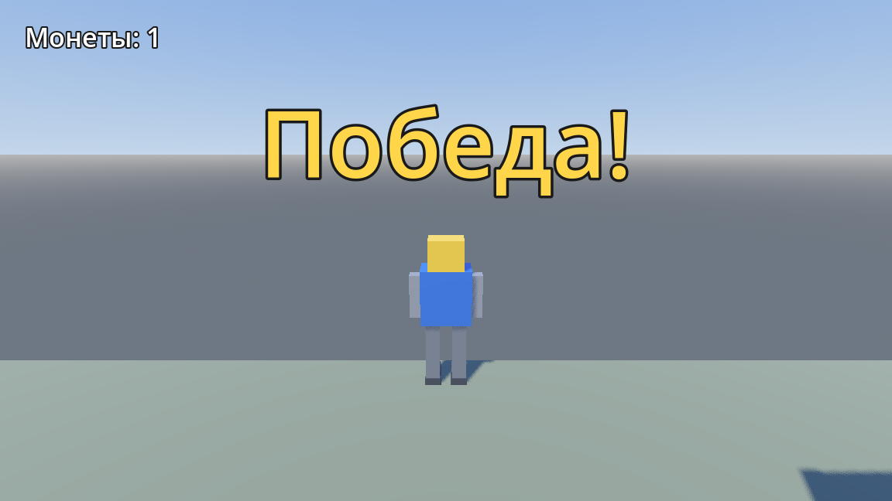

# 3D AI Game

Небольшая 3D-игра от третьего лица: робот бежит по лабиринту из деревянных ящиков,
собирает три монеты за 30 секунд и обновляет рекорд времени.



## Управление

| Клавиша | Действие |
|---|---|
| W / A / S / D | движение относительно камеры |
| Мышь | вращение камеры |
| Колесо мыши | зум (1.2 … 8 м) |
| Space | прыжок |
| R | перезапуск уровня |
| Esc | освободить курсор (клик — вернуть) |

## Правила

- На уровне три монеты; HUD показывает `Монеты: 0/3`.
- На прохождение даётся 30 секунд — таймер останавливается, когда окно теряет фокус.
- Победа — все три монеты. Лучшее время сохраняется в `user://best_time.cfg`
  и переживает перезапуск.
- Если время вышло — «Время вышло!», игрок останавливается.

## Стек

- Godot 4.7.2 (Forward+, Jolt Physics, D3D12)
- Ассеты: персонаж и ящик смоделированы в Blender и экспортированы в glTF
  (`models/player_robot.glb`, `models/obstacle.glb`); исходник робота — `models/player_robot.blend`.

## Сборка

Локально:

```bash
godot --headless --path . --export-release "Windows Desktop" build/3d_ai_game.exe
```

Пресет `Windows Desktop` лежит в `export_presets.cfg` (один файл, PCK встроен).

Перед релизной сборкой из `project.godot` убирается автозагрузка `MCPRuntimeProbe` —
это отладочный мост Godot MCP, в игре он не нужен (в CI это делает шаг workflow).

Готовый `.exe` прикладывается к релизу на GitHub; в репозиторий он не коммитится
(файл ~104 МБ, лимит GitHub — 100 МБ на файл).

## CI

`.github/workflows/build-windows.yml` собирает Windows-билд на каждый тег `v*`
и прикрепляет `.exe` к релизу.
